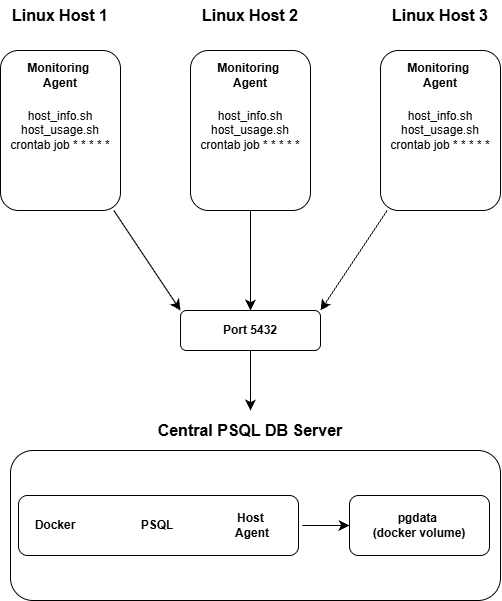

# Introduction
The Linux - Cluster Monitoring project is a MVP of a system monitoring application that records hardware specifications and resource usage data from Linux servers in real time. Each monitored host runs Bash scripts that sends information to a PostgreSQL database. Hardware details (CPU architecture, model, cache, memory) are recorded once and changing metrics (free memory, CPU activity, disk I/O, available disk space) are collected every minute. The frequency can be changed to any scheduling. The project is intended for the Linux Cluster Administration (LCA) team at Jarvis to be able to easily inspect server capacity and usage trends. Bash is used for automation and system data collection, Docker runs the PostgreSQL instance and cron schedules recurring measurements. PostgreSQL stores the monitoring data and finally Git and GitHub provide version control and deployment history.

# Quick Start
## Start a psql instance using psql_docker.sh
  
From "jarvis_data_eng_FawazMirza" cd into "linux_sql":

`cd linux_sql`

Make the scripts executable:

`chmod +x scripts/*.sh`

Create a psql docker container with the given username and password. This will create a container named `jrvs-psql`:

`./scripts/psql_docker.sh create db_username db_password`

To Start/Stop the container:

`./scripts/psql_docker.sh start` and `./scripts/psql_docker.sh stop`

Some extra info maybe printed out in the terminal, so press Ctrl C to get the cursor back.

Alternatively: `docker start jrvs-psql` and `docker stop jrvs-psql`

Run `docker ps` to see what containers are running.

## Create tables using ddl.sql

cd back to main directory: `cd ..`. You should be in "jarvis_data_eng_FawazMirza".

Start docker container:

`docker start jrvs-psql`

Run `docker ps` to make sure its running.

Run `sudo dnf install -y postgresql`

Set password for default user: `export PGPASSWORD='password'`

Finally, run this to connect to a psql instance: `psql -h localhost -U postgres -d postgres -W`

When connected (you should see `postgres=#` in the CLI) run:
`CREATE DATABASE host_agent;`

Run `\q` to exit psql instance. 

Run `psql -h localhost -U postgres -d host_agent -f sql/ddl.sql` to create the tables. You should see this outputted in the terminal:

**CREATE TABLE**

**CREATE TABLE**

Run these to connect to the psql instance and check whether the database and tables exist:

`psql -h localhost -U postgres -d postgres -W`
`\l` to list all databases.
`\c host_agent` to connect to the database.
`\dt` to list all tables. You should see 2 tables here.

## Insert hardware specs data into the DB using host_info.sh

From "jarvis_data_eng_FawazMirza" cd into "linux_sql":

`cd linux_sql`

Run `bash scripts/host_info.sh localhost 5432 host_agent postgres password` to insert hardware specs into the previously created tables. You should see this outputted in the terminal:

**INSERT 0 1**

Run these to connect to the psql instance `psql -h localhost -U postgres -d postgres -W`

Run `\c host_agent` to connect to the database.

Run `SELECT * FROM host_info;` to list all rows from this table.

## Insert hardware usage data into the DB using host_usage.sh

Run `bash scripts/host_usage.sh localhost 5432 host_agent postgres password` to insert hardware specs into the previously created tables. You should see this outputted in the terminal:

**INSERT 0 1**

Run these to connect to the psql instance `psql -h localhost -U postgres -d postgres -W`

Run `\c host_agent` to connect to the database.

Run `SELECT * FROM host_usage;` to list all rows from this table.

## Crontab setup

Run `crontab -e` to edit crontab jobs.

To run "host_usage.sh" every minute paste:

`* * * * * bash /path/to/your/host_usage.sh localhost 5432 host_agent postgres password > /tmp/host_usage.log`

Replace `/path/to/your/host_usage.sh` with your actual path.

Run: `pwd scripts/host_usage.sh` in the terminal to get the proper path.

My example:

`* * * * * bash /home/rocky/dev/jarvis_data_eng_FawazMirza/linux_sql/scripts/host_usage.sh localhost 5432 host_agent postgres password > /tmp/host_usage.log`

Then exit by clicking the "esc" key and type ":wq" in the file. (:q! to exit without saving).

Run `crontab -l` to see that the job created exists.

Run `cat /tmp/*.log` to see any relevant logs. You should see **INSERT 0 1** after at least a minute.

You can also print the rows within the host_usage table to see the new rows.

# Implemenation

The project was implemented as a set of Bash scripts connected to a centralized PostgreSQL database. The scripts use standard Linux commands to collect system information. Each script constructs an SQL statement and executes it through the `psql` instance.

Static hardware specifications are stored separately from changing usage measurements. This prevents the same hardware data from being inserted every minute. The hostname connects each Linux machine to its usage records through the `host_id` foreign key.

## Architecture

## Scripts

The commands and examples for running each script are provided in the Quick Start section. This section only describes each components purpose and implementation.

### psql_docker.sh

`psql_docker.sh` manages the PostgreSQL Docker container. It supports creating, starting and stopping the `jrvs-psql` container. During creation, it validates the database credentials, creates the `pgdata` volume and maps PostgreSQL to port `5432`. The volume stores the database files separately from the container so the data remains available after the container is stopped or removed.

See the Quick Start section for usage instructions.

### host_info.sh

`host_info.sh` collects static hardware specifications from a Linux host. It uses commands such as `hostname`, `lscpu` and `vmstat` to retrieve the hostname, CPU information, cache size and total memory. It constructs an SQL statement and inserts the results into `host_info`.

The script is only expected to run once per host because hardware specifications do not change regularly. The unique hostname constraint prevents duplicate host records.

See the Quick Start section for usage and verification instructions.

### host_usage.sh

`host_usage.sh` collects changing system-usage data, including free memory, idle CPU percentage, kernel CPU usage, disk I/O and available disk space. It uses the machines hostname to find the correct `host_id` from `host_info`, then inserts the measurement into `host_usage`.

Because the script depends on an existing `host_id`, `host_info.sh` must be executed before `host_usage.sh`.

See the Quick Start section for usage and verification instructions.

### crontab

Cron runs `host_usage.sh` automatically once every minute. This allows the system to collect usage measurements continuously without manual execution. The scripts output is written to a log file so successful inserts and errors can be reviewed.

See the Quick Start section for the cron configuration and management commands.

### queries.sql

Optional. Not implemented.

## Database Modeling

### host_info

| Column | Data type | Constraints | Description |
|---|---|---|---|
| `id` | `SERIAL` | Primary key, not null | Automatically generated identifier for the host. |
| `hostname` | `VARCHAR` | Unique, not null | Fully qualified hostname of the monitored machine. |
| `cpu_number` | `INT2` | Not null | Number of CPU cores available on the host. |
| `cpu_architecture` | `VARCHAR` | Not null | CPU architecture, such as `x86_64`. |
| `cpu_model` | `VARCHAR` | Not null | Name and model of the processor. |
| `cpu_mhz` | `FLOAT8` | Not null | CPU clock speed measured in MHz. |
| `l2_cache` | `INT4` | Not null | L2 CPU cache size measured in KB. |
| `timestamp` | `TIMESTAMP` | Not null | UTC time when the hardware information was collected. |
| `total_mem` | `INT4` | Not null | Total system memory measured in KB. |

### host_usage

| Column | Data type | Constraints | Description |
|---|---|---|---|
| `timestamp` | `TIMESTAMP` | Not null | UTC time when the usage information was collected. |
| `host_id` | `SERIAL` | Foreign key, not null | Identifies the monitored host by referencing `host_info.id`. |
| `memory_free` | `INT4` | Not null | Available system memory measured in MB. |
| `cpu_idle` | `INT2` | Not null | Percentage of CPU time spent idle. |
| `cpu_kernel` | `INT2` | Not null | Percentage of CPU time used by kernel processes. |
| `disk_io` | `INT4` | Not null | Number of disk I/O operations currently in progress. |
| `disk_available` | `INT4` | Not null | Available space in the root filesystem, measured in MB. |

# Test
I tested each component individually before testing the complete monitoring workflow.

The Docker script was tested by creating, stopping, and restarting the `jrvs-psql` container. I also tested its error handling for missing credentials, duplicate container creation and starting or stopping a nonexistent container.

I executed `ddl.sql` against the `host_agent` database. PostgreSQL returned two `CREATE TABLE` messages, and I verified the schema using commands like:

`psql -h localhost -U postgres -d host_agent -c "\dt"`
`psql -h localhost -U postgres -d host_agent -c "\d host_info"`
`psql -h localhost -U postgres -d host_agent -c "\d host_usage"`

I also ran the scripts with bash -x during development. This printed each command after variable expansion, which helped me identify incorrect parsed values, missing units and errors in the generated SQL statements. 

I ran both monitoring scripts manually. Each successful insert returned:

**INSERT 0 1**

I verified the inserted data using:

`psql -h localhost -U postgres -d host_agent -c "SELECT * FROM host_info;`

`psql -h localhost -U postgres -d host_agent -c "SELECT * FROM host_usage;`

Finally, I scheduled `host_usage.sh` with cron and confirmed that a new row appeared every minute. The cron output was reviewed through `/tmp/host_usage.log`.

# Deployment

I deployed the project source code to GitHub using separate feature branches for the Docker setup, database DDL and monitoring scripts. After testing each feature, I merged it into the `develop` branch through pull requests.

PostgreSQL was deployed inside the `jrvs-psql` Docker container, with port `5432` exposed for local connections. A named Docker volume called `pgdata` was used to persist the database files independently of the container. The DDL script created the required tables, while `host_info.sh` registered the Linux host. Finally, I configured crontab to execute `host_usage.sh` every minute and write its output to a log file.

# Improvements
- Add a dashboard to visualize CPU, memory and disk usage trends for each host.
- Add automatic alerts when CPU, memory or disk usage passes a defined limit.
- Automatically detect and update hardware information when a hosts specifications change.
